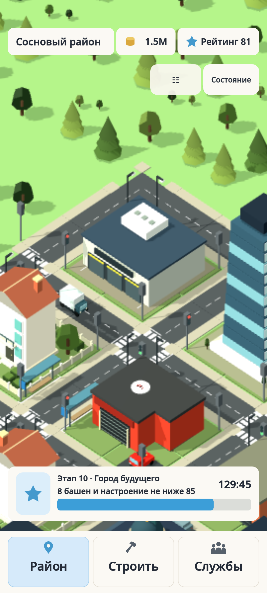

# Проверка очередей транспорта на Galaxy S21+

**Дата:** 11 ноября 2026 года
**Устройство:** Samsung Galaxy S21+ (SM-G996B), `org.fixmytown.prototype`
**Версия:** 0.5.25 / versionCode 32 → 0.5.26-queue-fix / versionCode 33
**Установка:** `adb install -r` завершилась успешно; приложение не удалялось, данные не очищались.

## Результат наблюдения

Игра оставалась на переднем плане не менее пяти минут. На показанной части города автомобили меняли положение и продолжали проезжать сигнальные узлы. За время наблюдения визуально не замечено сцепления корпусов, столкновения или перекрытия перекрёстка; постоянный затор не возник. Конкретный случай с двумя логистическими грузовиками, одновременно ожидающими красный сигнал, воспроизвести не удалось — его поведение на устройстве остаётся непроверенным.

## Сохранение

До запуска сохранена побайтная копия `progress.json` (SHA256: `D1C164491503CA4AD6BC7A345B04B722FAC687169472B9134D736D23C979AE97`). Копия хранится локально в `outputs/phone-queue-check-20261111/progress-before-0.5.26.json` и в репозиторий не добавлена.

До и после: `city_id` — `fix_my_town`, этап — 10, 23 здания. Список типов, координат и уровней зданий совпал. Бюджет вырос с 1 485 775 до 1 496 328 за счёт игрового дохода.

Во входном сохранении находились две записи `fire` в общем списке происшествий на один дом, при пустом списке `fires`. После наблюдения эти записи отсутствовали, а в `fires` были два активных пожара: электрическая неисправность в `pine_district_elite_residence_15_22` (повреждение 43,0%) и распространение на `pine_district_business_tower_15_19` (26,2%). Это произошло во время активной симуляции. Игроком не выполнялись строительство, снос или трата денег; резервную копию не восстанавливали. Снимок после проверки также сохранён локально.

Игра запустилась без сбоя; в просмотренном журнале не найдено ошибок Godot или аварийного завершения. После проверки приложение отправлено в фон.

## Автоматические проверки и сборка

Перед APK прошёл полный `tools/run_checks.ps1` на Godot 4.7.2; весь набор зарегистрированных проверок завершился успешно. APK собран для `arm64-v8a`, SHA256: `99334131EEA9DD3299E5E821E856C2858C88C3E02E315682AFA33B77811541AB`.

APK был собран из локального дерева на базе `c2fa5fa` с незакоммиченными изменениями. Данный документ сообщает результат установки и наблюдения; он сам по себе не публикует незакоммиченный исходный код. Видео и копии сохранения оставлены локально в `outputs/phone-queue-check-20261111/` и в GitHub не отправлялись.
